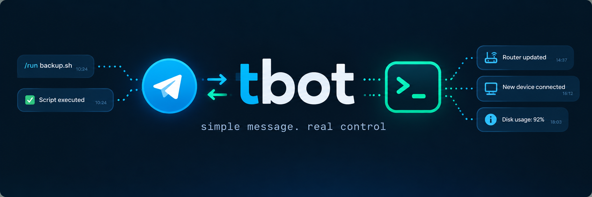

# tbot — Telegram commands and notifications for OpenWrt and Linux

tbot is a small C++20 Telegram bot that turns a chat into a control panel and
notification channel for your device. Run your own shell scripts through menu
buttons or commands, read their output in Telegram, and receive messages from
scheduled jobs and other devices.

**Its main purpose is remote control and notifications for OpenWrt routers.**
OpenWrt packages, service integration, LuCI administration and ready-made scripts
for router status, DHCP leases and Wi-Fi clients live in the companion
[tbot-wrt](https://github.com/ja-pa/tbot-wrt) repository.

The core bot in this repository also runs on a regular **Linux system**, without
OpenWrt or LuCI. Use it on a server, workstation or other Linux device with
scripts suited to that host. The build and quick start below cover this setup.

## The tbot philosophy

Keep everyday operations a message or a button press away. You define the
available actions; tbot connects them to Telegram and brings the results back.

- **A menu for routine tasks.** Send `/start` or `/help` to see available
  commands. Give your scripts readable button labels and arrange them in rows,
  or call them directly with `/command_name`. Extend the bot by adding scripts
  and command entries.
- **OTP for selected actions.** An allowed-user list controls who can run
  commands. Mark sensitive commands with `requires_2fa` to require a time-based
  one-time password (TOTP) from an authenticator app. In a private chat,
  `/auth 123456` unlocks protected commands for five minutes; `/lock` locks them
  immediately. Protected commands are hidden and unavailable while locked.
- **Messages in both directions.** You can ask the device to do something, but
  it can also notify you without a command first. Use `tbot-send` from local
  scripts or cron jobs, or the optional HTTP endpoint from a trusted LAN or VPN,
  to send backup results, monitoring alerts or other messages to configured chats.

## How it works

The daemon runs on your router or Linux host and receives Telegram updates using
long polling over an outbound connection. Telegram commands do not require an
inbound port or a public webhook. After checking the sender and any required
2FA session, tbot runs the configured script under its own process account and
returns the output to the chat.

Two JSON files define the behavior: `config.json` holds Telegram access,
notification destinations and 2FA settings; `commands.json` maps commands and
menu buttons to scripts. The core example command list is empty, ready for your
own actions. See [Custom commands](docs/user-guide.md#custom-commands) for an
example.

Notifications use the same running daemon. The local `tbot-send` client passes
text through a Unix socket, so your scripts do not need the Telegram token.
The optional HTTP endpoint accepts messages from other devices and is disabled
by default. Both send to the configured notification chats. See the
[notification guide](docs/user-guide.md#local-notifications) for setup and
delivery limitations.

## Build

On Ubuntu or Ubuntu under WSL, from the repository root:

```sh
sudo apt install build-essential cmake ninja-build git libcurl4-openssl-dev libmicrohttpd-dev pkg-config
cmake -S . -B build -G Ninja -DCMAKE_BUILD_TYPE=Debug
cmake --build build
ctest --test-dir build --output-on-failure
```

Requires Linux, CMake 3.22+, a C++20 compiler and libmicrohttpd 0.9.71+.
See the [development guide](docs/development.md) for dependencies and build options.

## Quick start

Create a bot with [@BotFather](https://t.me/BotFather), then copy the examples:

```sh
cp config/examples/config.json config.json
cp config/examples/commands.json commands.json
chmod 600 config.json
```

Set `telegram.token`, `telegram.allowed_user_ids` and `notifications.chat_ids`
in `config.json`. The [user guide](docs/user-guide.md#telegram-setup) explains
how to find these IDs.

```sh
./build/tbot -c config.json
# In another terminal, while the bot is running:
./build/tbot-send "Backup complete"
```

Send `/start` or `/help` to the bot. The example command list is empty; add
your own scripts when ready. Press Ctrl+C to stop.

## Documentation

| Guide | Contents |
| --- | --- |
| [User guide](docs/user-guide.md) | Telegram setup, configuration, commands, 2FA, notifications and troubleshooting |
| [Development guide](docs/development.md) | Build options, architecture, protocols, administration backend and tests |

Built-in text is English. User-defined descriptions, button labels and messages
can use other languages. Existing configuration, socket paths and paired 2FA
secrets remain compatible.
